# Visione Strategica e Architettura dell'Ecosistema Logistico Integrato — NORSAN / ZREEN (Hub di Bolzano)
**Piano di Evoluzione Graduale: dalla Postazione di Imballaggio (Fase 1) al Sistema WMS Completo (Fasi 2–4)**

- **Autore e Product Owner / Project Manager:** Serhii Haharin
- **Sede Operativa:** Hub Logistico di Bolzano (BZ), Italia — NORSAN S.r.l. / ZREEN Nutraceutica
- **Stato Attuale di Configurazione ([`wmsPhaseConfig.ts`](../src/config/wmsPhaseConfig.ts)):**
  - **Fase 1 (Attiva in Produzione / Live):** Terminale Postazione di Imballaggio (`Packing Station Terminal`)
  - **Fasi 2–4 (Congelate nell'Interfaccia / Già Progettate a Livello Architetturale):** Ricezione Merce e Pedane (Inbound), Posizionamento Indirizzato e Slotting 5S (Put-Away), Tracciabilità Lotti e Scadenze (FEFO / HACCP), Scarico Automatico Giacenze e Sincronizzazione Bidirezionale Selly ERP.

---

## 1. Executive Summary & Business Case (Razionale Strategico)

### 1.1. Perché un rilascio graduale in due livelli operativi
Nella fase attuale, l'esigenza prioritaria del magazzino di Bolzano è **massimizzare la velocità e la precisione al banco di imballaggio**, mantenendo invariato il flusso consolidato voluto dalla direzione: *stampa delle distinte di prelievo da Selly ERP $\rightarrow$ scansione rapida del foglio d'ordine al banco $\rightarrow$ emissione immediata dell'etichetta termica DHL*.

Per questo motivo la **Fase 1** opera esclusivamente come **Postazione di Imballaggio Pura**:
- Non richiede al team di magazzino o all'ufficio di modificare subito le procedure di carico pedane o di registrazione lotti.
- L'operatore al banco ottiene l'apertura immediata dell'ordine tramite scansione del codice a barre sulla distinta, il suggerimento visivo dello scaffale (`S2-A`, `D1-C`), la verifica della scatola corretta (`NORSAN`, `ZREEN` o cartone neutro `Amazon FBM`) e la stampa istantanea dell'etichetta DHL con gestione dei colli multipli (`+COLLO`).

Parallelamente, in ottica di **Project Management / Product Ownership**, l'intera architettura delle **Fasi 2–4** è già stata sviluppata nel codice e nel database SQLite, ma mantenuta **congelata nell'interfaccia** tramite il file di controllo [`wmsPhaseConfig.ts`](../src/config/wmsPhaseConfig.ts). Nel momento in cui verrà avviato il coordinamento gestionale in ufficio, questi moduli permetteranno di estendere il sistema a **tutto l'ecosistema di magazzino (End-to-End WMS)** senza costi di riprogettazione.

---

## 2. Architettura End-to-End dell'Ecosistema di Magazzino (Modello MECE in 5 Stadi)

Il modello copre l'intero ciclo di vita fisico e informativo del prodotto all'interno dell'Hub di Bolzano secondo il principio **MECE** (*Mutually Exclusive, Collectively Exhaustive*):

```mermaid
flowchart LR
    subgraph P2["FASE 2 (Congelata): Ricezione & Inbound"]
        A["1. Arrivo Camion da Berlino\n(Pedane NORSAN / ZREEN)"] --> B["2. Registrazione Pedana,\nLotto FEFO (L2705N) e Scadenza"]
    end

    subgraph P3["FASE 3 (Congelata): Stoccaggio & Controllo FEFO"]
        B --> C["3. Stoccaggio in Zona Pedane\n(PALLET-N / PALLET-Z)"]
        C --> D["4. Rifornimento Kanban (1-Click)\n(Pedana → Scaffale Picking)"]
        D --> E["5. Rotazione FEFO su Scaffale\n(Lotto Frontale vs. Lotto Posteriore)"]
    end

    subgraph P1["FASE 1 (ATTIVA IN PRODUZIONE): Postazione Imballaggio"]
        E --> F["6. Importazione Selly ERP &\nStampa Distinta con Barcode"]
        F --> G["7. Scansione Distinta al Banco →\nStampa Etichetta DHL + Multi-Collo (+COLLO)"]
    end

    subgraph P4["FASE 4 (Congelata): Scarico Automatico & ERP Sync"]
        G --> H["8. Scarico Automatico Flaconi\ndallo Scaffale a Chiusura Ordine"]
        H --> I["9. Allineamento Giacenze e Tracking\nverso Selly ERP"]
    end
```



---

## 3. Dettaglio Funzionale dei Moduli Congelati (Fasi 2–4)

### Stadio A. Ricezione Prodotti da Berlino e Controllo Ingrasso (Inbound Gate Reception)
- **Problema Operativo:** All'arrivo dei bancali dalla sede centrale di Berlino, il conteggio dei cartoni chiusi, i numeri di lotto (`Lotto`) e le date di scadenza (`Scadenza`) vengono spesso gestiti separatamente rispetto alla postazione di imballaggio, creando disallineamenti tra giacenza fisica e giacenza contabile in Selly ERP.
- **Soluzione Progettata ([`receiveInboundPallet`](../src/services/mainWarehouseInventoryService.ts)):**
  - Alla ricezione della merce si seleziona lo SKU, si inserisce il numero di cartoni chiusi sulla pedana (es. `30 cartoni × 20 flaconi = 600 pz`), il codice lotto (`L2705N`) e la data di scadenza (`11/2027`).
  - Il sistema aggiorna istantaneamente lo stock in zona pallet (`closedCartonsOnPallet`) e associa il lotto di produzione allo SKU.

### Stadio B. Posizionamento a Due Livelli (Pedane + Scaffali) e Rifornimento Kanban (5S Slotting)
- **Problema Operativo:** Il magazzino è diviso fisicamente tra **Zona Pedane** (cartoni master sigillati) e **Scaffali di Prelievo** (flaconi sciolti vicino ai banchi `ST-01..ST-03`). Un'unica cifra aggregata non permette di sapere se lo scaffale di prelievo è vuoto mentre i cartoni sono ancora sulla pedana.
- **Soluzione Progettata ([`mainWarehouseInventoryService.ts`](../src/services/mainWarehouseInventoryService.ts)):**
  - **Livello 1 — Zona Pedane (`PALLET-N / PALLET-Z`):** Conteggio in cartoni chiusi (`closedCartonsOnPallet × unitsPerCarton`).
  - **Livello 2 — Scaffali di Imballaggio (`Scaffale Sinistro S / Destro D`, piani 1–5):** Conteggio in singoli flaconi (`openUnitsOnPackingShelf`), posizionati secondo la curva ABC di rotazione (*Golden Zone* ad altezza braccia per gli articoli ad alta rotazione come `Omega-3 Total`, `Vegan`, `Arktis`).
  - **Trasferimento Kanban in 1 Click:** Quando un cartone sullo scaffale si esaurisce, l'operatore preme `Kanban → Scaffale`: il sistema scala automaticamente `-1 cartone` dalla pedana e carica `+20/+24 flaconi` sullo scaffale di prelievo.

### Stadio C. Gestione Lotti FEFO, Scadenze e Richiamo Lotti (Conformità HACCP / Reg. CE 178/2002)
- **Problema Operativo:** Gli integratori Omega-3 e nutraceutici richiedono una rigorosa rotazione per data di scadenza (*First-Expired, First-Out*). Se un nuovo cartone viene posizionato davanti a uno già aperto, si rischia di spedire lotti più recenti lasciando scadere i flaconi più vecchi.
- **Soluzione Progettata ([`lotTraceabilityService.ts`](../src/services/lotTraceabilityService.ts)):**
  - Gestione simultanea di due lotti sullo stesso scaffale: **Lotto Frontale Prioritario** (da esaurire per primo) e **Lotto Secondario di Riserva**.
  - Calcolo predittivo del rischio di scadenza in Euro (`writeOffRiskEur`): il sistema confronta i pezzi totali presenti in magazzino con la velocità mensile di vendita (`monthlySalesVelocity`) e i mesi residui alla scadenza, segnalando con 90 giorni di anticipo eventuali sovra-scorte per attivare promozioni mirate o bundle commerciali.
  - Motore di ricerca istantanea per **Richiamo Lotto (`Batch Recall`)** in caso di controlli qualità.

### Stadio D. Scarico Automatico a Fine Imballaggio e Allineamento Selly ERP
- **Problema Operativo:** Lo scarico manuale o l'inventario periodico generano scostamenti tra il magazzino reale e Selly ERP (es. omaggi, sostituzioni o rotture non registrate).
- **Soluzione Progettata ([`server/index.ts`](../server/index.ts) & [`deductPackedOrderFromShelf`](../src/services/mainWarehouseInventoryService.ts)):**
  - Nel momento esatto in cui l'ordine passa allo stato `packed`, una transazione atomica su database SQLite sottrae la quantità spedita (`quantity_required`) direttamente dallo scaffale di prelievo (`open_units_on_packing_shelf`) e dal saldo atteso ERP.
  - Il modulo **Conta / Rettifica Rapida (`Smart Cycle Count`)** consente al responsabile di verificare e riallineare qualsiasi SKU in 30 secondi senza bloccare le spedizioni.

---

## 4. Prioritizzazione MoSCoW delle Fasi di Rilascio

| Categoria MoSCoW | Modulo / Funzionalità | Stato nel Codice | Fase di Attivazione |
| :--- | :--- | :--- | :--- |
| **MUST-HAVE** *(Attivo ora al banco)* | • Accesso tramite codice/badge operatore (`OP-01`, `OP-02`, `TL-01`)<br>• Importazione ordini Selly ERP e stampa distinte A4 con barcode Code 128<br>• Scansione distinta $\rightarrow$ stampa immediata etichetta DHL (o a fine imballaggio)<br>• Aggiunta scatole extra (`+COLLO`) con stampa del solo nuovo collo<br>• Mappa scaffali (5S Slotting) e controllo scatola NORSAN / ZREEN / Amazon | **ATTIVO IN PRODUZIONE** (`Fase 1 Live`) | **Fase 1 (Attuale)** — Postazione di Imballaggio |
| **SHOULD-HAVE** *(Primo passo in ufficio)* | • Integrazione API diretta con Selly ERP e DHL API (Waybill ufficiale automatico)<br>• Scarico automatico dei flaconi dallo scaffale a ogni ordine completato | Sviluppato nel codice, **CONGELATO** | **Fase 2** — Integrazione API & Scarico Automatico |
| **COULD-HAVE** *(Estensione a tutto il magazzino)* | • Gestione inventario a due livelli (`Pedane` + `Scaffali`) e ricezione bancali da Berlino<br>• Tracciabilità completa lotti FEFO, scadenze e avvisi rischio invenduto | Sviluppato nel codice, **CONGELATO** | **Fase 3** — Ecosistema Magazzino Completo (WMS) |
| **WON'T-HAVE (Ora)** *(Escluso nella Fase 1)* | • Scansione obbligatoria di ogni singolo flacone prima della stampa DHL<br>• Visualizzazione di lotti FEFO e saldi pedane sul terminale dell'imballatore nella Fase 1 | **DISATTIVATO** | — |

---

## 5. User Stories e Criteri di Accettazione (Acceptance Criteria)

### US-01 (Fase 1 — Attiva): Imballaggio rapido da distinta cartacea e gestione multi-collo
> **As a** Addetto all'Imballaggio (`ST-01`),  
> **I want to** scansionare il codice a barre sulla distinta cartacea per visualizzare subito gli articoli con le coordinate scaffale e stampare immediatamente l'etichetta DHL (aggiungendo colli extra con `+COLLO` se necessario),  
> **So that** posso completare i pacchi alla massima velocità senza inserimenti manuali o scansioni pezzo per pezzo.

**Criteri di Accettazione:**
1. La scansione del barcode della distinta apre l'ordine a schermo e invia subito la stampa termica DHL (`100x150mm`).
2. Se il numero di scatole non è noto a priori, l'operatore può impostare `DHL: A Chiusura` oppure scansionare il comando da banco `+COLLO` per stampare **esclusivamente** l'etichetta della nuova scatola (`Collo 2/2`).
3. Le schede prodotto mostrano solo i dati essenziali al prelievo (Posizione Scaffale, Foto, Nome, EAN, Quantità), mantenendo nascosti i campi FEFO/Inventario congelati per le fasi successive.

### US-02 (Fase 2 — In Riserva Strategica): Ricezione bancali e rifornimento Kanban degli scaffali
> **As a** Responsabile Logistica / Product Owner,  
> **I want to** registrare le pedane in arrivo da Berlino con numero di cartoni, lotto FEFO e scadenza, e tracciare i trasferimenti Kanban dalla pedana allo scaffale di prelievo,  
> **So that** il magazzino abbia sempre visibilità esatta tra scorta chiusa su pallet e flaconi aperti al banco.

**Criteri di Accettazione:**
1. La registrazione di un `Inbound Pallet` incrementa i cartoni chiusi nella rispettiva zona (`PALLET-N-*` / `PALLET-Z-*`) e aggiorna il lotto associato allo SKU.
2. Il comando `Kanban → Scaffale` sottrae 1 cartone dalla pedana e aggiunge `20` o `24` flaconi allo scaffale di imballaggio.

### US-03 (Fase 3 — In Riserva Strategica): Scarico automatico giacenze e prevenzione scadenze (FEFO)
> **As a** Operations Manager / Business Strategist,  
> **I want** che ogni ordine completato scarichi automaticamente i flaconi dallo scaffale nel database e segnali con 90 giorni di anticipo i lotti a rischio scadenza rispetto al ritmo di vendita,  
> **So that** le discrepanze di inventario con Selly ERP e le perdite per merce scaduta siano azzerate.

**Criteri di Accettazione:**
1. Il passaggio dell'ordine allo stato `packed` decrementa automaticamente lo stock dello scaffale nel database SQLite.
2. Il pannello di direzione calcola i mesi di copertura (`monthsOfStockRemaining`) ed evidenzia i lotti che superano la capacità di assorbimento prima della data di scadenza.

---

## 6. Matrice delle Responsabilità RACI (Transizione Fase 1 $\rightarrow$ Ecosistema Completo)

| Processo / Stadio | Operatore (`OP-01..03`) | Team Lead (`TL-01`) | PM / Product Owner *(Serhii Haharin)* | Team IT / Selly ERP | Direzione NORSAN / ZREEN |
| :--- | :---: | :---: | :---: | :---: | :---: |
| **1. Operatività Postazione Imballaggio (Fase 1)** | **R** | **A** | **C** | **I** | **I** |
| **2. Stampa Distinte & Gestione Coda Giornaliera** | **I** | **R / A** | **C** | **I** | **I** |
| **3. Architettura WMS & Roadmap Ecosistema (Fasi 2–4)** | **I** | **C** | **R / A** | **C** | **Approvazione** |
| **4. Connettori API Selly ERP & DHL Express/Parcel** | **I** | **I** | **A** | **R** | **C** |
| **5. Gestione Pedane, Lotti FEFO e Scarico Automatico** | **C** | **R** | **A** | **C** | **I** |

*(R — Responsible / Esecutore, A — Accountable / Responsabile del Risultato, C — Consulted / Consultato, I — Informed / Informato)*

---

## 7. Riattivazione Tecnica dei Moduli Congelati (Fasi 2–4)

Tutti i moduli dell'ecosistema di magazzino sono già presenti nel repository e controllati dal file centrale [`src/config/wmsPhaseConfig.ts`](../src/config/wmsPhaseConfig.ts). Per attivarli al momento del passaggio alla Fase 2–3 è sufficiente modificare i flag booleani:

```typescript
export const WMS_PHASE_CONFIG = {
  PHASE_1_PACKING_STATION_ONLY: true,    // Impostare su false per sbloccare le Fasi 2-4
  ENABLE_FEFO_LOT_TRACKING: false,       // Impostare su true per attivare Lotti e Scadenze FEFO
  ENABLE_WAREHOUSE_INVENTORY_ERP: false, // Impostare su true per attivare Inventario Pedane e Scarico Automatico
  ENABLE_LEAN_ANALYTICS_TABS: false,     // Impostare su true per attivare le Metriche Lean & Kaizen
};
```
