# Strategia & Architettura dell'Ecosistema Logistico Integrato — NORSAN / ZREEN (Hub di Bolzano)
**Візія та Дорожня Карта розвитку складської екосистеми (від Робочої Станції Пакувальника до повноцінної WMS)**

- **Автор та власник продукту (Product Owner / Project Manager):** Serhii Haharin (Сергій Гагарін)
- **Локація:** Hub Logistico Bolzano (BZ), Italia — NORSAN S.r.l. / ZREEN Nutraceutica
- **Поточний статус у коді (`WMS_PHASE_CONFIG`):**
  - **Фаза 1 (В бойовому режимі / Active Live):** Робоча станція пакувальника (`Packing Station Terminal`)
  - **Фази 2–4 (Заморожені в UI / Архітектурно спроєктовані для масштабування):** Приймання палет (Inbound), Адресне зберігання (Put-Away & 5S Slotting), FEFO-контроль партій і термінів придатності, Автоматичне списання залишків та синхронізація з Selly ERP.

---

## 1. Executive Summary & Business Case (Обґрунтування стратегії)

### 1.1. Чому запуск розділено на 2 контури (Стратегія поступового впровадження)
На поточному етапі головне вузьке місце операцій на складі в Больцано — це **швидкість і точність комплектації на пакувальному столі** при збереженні існуючого процесу друку паперових накладних із Selly ERP.

Саме тому **Фаза 1** свідомо сфокусована виключно на **Робочій Станції Пакувальника**:
- Вона не вимагає від офісу чи складу одномоментної перебудови процесів обліку палет і партій.
- Пакувальник отримує миттєву візуалізацію замовлення по скану накладної, автоматичний друк етикетки DHL (включно з мульти-коробками `+COLLO`) та підказку комірки стелажа (`S2-A`, `D1-C`).

Водночас, як **Project Manager / Product Owner**, я заклав у кодову базу та базу даних SQLite повну архітектуру **Фаз 2–4** (зараз заморожену прапорцем `PHASE_1_PACKING_STATION_ONLY = true` у [`wmsPhaseConfig.ts`](../src/config/wmsPhaseConfig.ts)). При переході до управління проєктом модернізації складу в офісі ці модулі дозволять розгорнути **замкнений цикл керування складом (End-to-End WMS)** без переписування системи з нуля.

---

## 2. Наскрізна архітектура екосистеми складу (MECE: 5 етапів руху товару)

Модель розвитку охоплює весь життєвий цикл продукції NORSAN та ZREEN на складі в Больцано за принципом **MECE** (жоден фізичний рух пляшки не залишається поза системою):

```mermaid
flowchart LR
    subgraph P2["ФАЗА 2 (Заморожено): Inbound & Приймання"]
        A["1. Прибуття фури з Берліна\n(Палети NORSAN / ZREEN)"] --> B["2. Реєстрація палети,\nFEFO-лота (L2705N) та Scadenza"]
    end

    subgraph P3["ФАЗА 3 (Заморожено): Склад та FEFO-Ротація"]
        B --> C["3. Розміщення в зоні педан\n(PALLET-N / PALLET-Z)"]
        C --> D["4. Kanban-поповнення стелажів\n(Педана → Стелаж пакування)"]
        D --> E["5. FEFO-контроль термінів\nта ротація задньої/передньої коробки"]
    end

    subgraph P1["ФАЗА 1 (АКТИВНА В БОЙОВОМУ РЕЖИМІ): Станція Пакувальника"]
        E --> F["6. Імпорт Selly ERP &\nДрук накладної зі штрихкодом"]
        F --> G["7. Скан накладної на столі →\nМиттєва етикетка DHL + Мульти-ящик (+COLLO)"]
    end

    subgraph P4["ФАЗА 4 (Заморожено): Автосписання & ERP Sync"]
        G --> H["8. Автоматичне віднімання пляшок\nзі стелажа при закритті замовлення"]
        H --> I["9. Двостороння синхронізація\nзалишків і трекінгу з Selly ERP"]
    end
```



---

## 3. Детальний опис заморожених модулів екосистеми (Фази 2–4)

### Етап А. Отримання продукту та вхідний контроль (Inbound Gate Reception)
- **Бізнес-проблема:** При розвантаженні палет із центрального хабу (Берлін) дані про кількість закритих ящиків, номери партій (`Lotto`) і дати придатності (`Scadenza`) вносяться вручну або із затримкою, що створює розрив між фізичним складом і Selly ERP.
- **Як спроєктовано в системі:**
  - При прибутті палети відповідальний працівник обирає SKU, вводить кількість закритих ящиків (наприклад, `30 ящиків × 20 пляшок = 600 шт`), номер партії (`L2705N`) та термін придатності (`11/2027`).
  - Система автоматично перераховує фізичний залишок у зоні палет (`closedCartonsOnPallet`) і прив'язує партію до SKU ([`receiveInboundPallet`](../src/services/mainWarehouseInventoryService.ts)).

### Етап Б. Дворівневе адресне розміщення та Kanban-поповнення (Two-Tier Storage & 5S Slotting)
- **Бізнес-проблема:** Склад фізично поділений на **Зону Палет** (закриті майстер-картони) та **Стелажі Пакування** (відкриті ящики біля столів `ST-01..ST-03`). Якщо змішувати їх в одну цифру, пакувальник не знає, чи є товар під рукою на полиці, а керівник не бачить, коли закінчуються палети.
- **Як спроєктовано в системі:**
  - **Рівень 1 — Педани (`PALLET-N / PALLET-Z`):** Облік у закритих коробках (`closedCartonsOnPallet × unitsPerCarton`).
  - **Рівень 2 — Стелажі комплектації (`Scaffale S/D`, рівні 1–5):** Облік у відкритих пляшках (`openUnitsOnPackingShelf`), розміщених за ABC-частотою продажів («Золота зона» на рівні рук для топ-позицій `Omega-3 Total`, `Vegan`, `Arktis`).
  - **Kanban-переміщення в 1 клік:** Коли на столі закінчується відкрита коробка, пакувальник натискає сигнал Kanban — система списує `-1 коробку` з палети і додає `+20 пляшок` на полицю пакування ([`transferCartonsToPackingShelf`](../src/services/mainWarehouseInventoryService.ts)).

### Етап В. Контроль партій FEFO, термінів придатності та відкликання (HACCP / Reg. CE 178/2002)
- **Бізнес-проблема:** Омега-3 та нутрицевтики мають суворий термін придатності. Якщо при поповненні полиці нову коробку поставлять поверх старої, виникає ризик відправки клієнту товару з меншим залишковим терміном або списання простроченої партії.
- **Як спроєктовано в системі ([`lotTraceabilityService.ts`](../src/services/lotTraceabilityService.ts)):**
  - Підтримка двох одночасних партій на одній полиці: **фронтальна коробка** (яка добирається першою за правилом *First-Expired, First-Out*) та **резервна коробка** позаду.
  - Автоматичний розрахунок ризику списання у євро (`writeOffRiskEur`): система порівнює поточний залишок на складі зі швидкістю продажів (`monthlySalesVelocity`) і кількістю місяців до закінчення терміну придатності. Якщо склад не встигає продати партію до дати `Scadenza`, система за 90 днів підсвічує позицію для проведення промо-акції або бандлу.
  - Миттєвий пошук замовлень за номером партії (`Batch Recall`) на випадок запиту контролюючих органів.

### Етап Г. Автоматичне віднімання товару при пакуванні та звірка з Selly ERP
- **Бізнес-проблема:** Ручне списування залишків або звірка раз на квартал призводять до помилок у залишках («в ERP числиться 180 шт, по факту на полиці 176 шт»).
- **Як спроєктовано в системі ([`server/index.ts`](../server/index.ts) & [`mainWarehouseInventoryService.ts`](../src/services/mainWarehouseInventoryService.ts)):**
  - Як тільки пакувальник закриває замовлення (або сканує наступну накладну), транзакція БД автоматично віднімає відправлену кількість пляшок зі стелажа (`open_units_on_packing_shelf`) та очікуваного залишку ERP.
  - Інструмент швидкої циклічної інвентаризації (`Smart Cycle Count`) дозволяє за 30 секунд звірити будь-який SKU (Палети + Полиця) з цифрою в Selly ERP і вирівняти баланс.

---

## 4. Пріоритезація впровадження за методологією MoSCoW

| Категорія MoSCoW | Модуль / Функціонал | Статус у коді | Етап розгортання |
| :--- | :--- | :--- | :--- |
| **MUST-HAVE** *(Працює зараз на столі)* | • Вхід за бейджем/кодом оператора (`OP-01`, `OP-02`, `TL-01`)<br>• Імпорт накладних Selly ERP та друк аркушів зі штрихкодом Code 128<br>• Скан накладної $\rightarrow$ миттєвий друк етикетки DHL (або в кінці пакування)<br>• Додавання коробок (`+COLLO`) із друком тільки нового місця<br>• Карта стелажів (5S Slotting) та підказка коробок NORSAN / ZREEN / Amazon | **АКТИВНО** (`Phase 1 Live`) | **Фаза 1 (Поточна)** — Робоча станція пакувальника |
| **SHOULD-HAVE** *(Перший крок після переведення в офіс)* | • Пряма інтеграція з API Selly ERP та DHL API (офіційний Waybill без ручного експорту)<br>• Автоматичне списання пляшок зі стелажа при кожному упакованому замовленні | Спроєктовано в коді, **ЗАМОРОЖЕНО** | **Фаза 2** — Інтеграція API та автосписання |
| **COULD-HAVE** *(Масштабування на весь склад)* | • Дворівневий облік складу (`Педани` + `Полиці`) та приймання фур із Берліна<br>• Повний облік партій FEFO, термінів придатності та попередження про ризик списання | Спроєктовано в коді, **ЗАМОРОЖЕНО** | **Фаза 3** — Повна складська екосистема (WMS) |
| **WON'T-HAVE (Зараз)** *(Виключено для збереження швидкості)* | • Обов'язкове поштучне сканування кожної пляшки перед друком DHL (скасовано за рішенням керівництва)<br>• Відкритий перегляд FEFO/інвентарю на терміналі пакувальника під час Фази 1 | **ВИМКНЕНО** | — |

---

## 5. User Stories та Критерії Приймання (Acceptance Criteria) для Фаз 1–3

### US-01 (Фаза 1 — Активна): Миттєве пакування за сканом накладної та мульти-коробки
> **As a** Packer (Пакувальник на станції `ST-01`),  
> **I want to** scan the barcode on the printed packing slip to immediately see the order items, shelf coordinates, and print the DHL label (plus scan `+COLLO` if an extra box is needed),  
> **So that** I can pack orders at maximum speed without manual data entry or scanning every single bottle.

**Acceptance Criteria (Критерії приймання):**
1. При скануванні штрихкоду накладної замовлення миттєво відкривається на екрані та відправляє на термопринтер етикетку DHL (`100x150mm`).
2. Якщо пакувальник не знає наперед кількість коробок, він може перемкнути режим `DHL: A Chiusura` або в будь-який момент відсканувати штрихкод `+COLLO` — система надрукує **тільки** етикетку для нового місця (`Collo 2/2`).
3. На екрані пакувальника немає зайвих полів партій чи складського обліку, які відволікають від збирання замовлення.

### US-02 (Фаза 2 — В резерві для офісу): Приймання палет та адресне поповнення стелажів
> **As a** Warehouse Manager / Product Owner,  
> **I want to** register incoming pallets from Berlin with their carton count, FEFO lot number, and expiry date, and track Kanban transfers from pallet to packing shelf,  
> **So that** the system always knows the exact stock on pallets vs. open bottles on the packing rack.

**Acceptance Criteria (Критерії приймання):**
1. При проведенні `Inbound Pallet` кількість закритих коробок додається до відповідної палетної зони (`PALLET-N-*` / `PALLET-Z-*`), а лот фіксується за SKU.
2. Операція `Kanban → Scaffale` списує 1 закриту коробку з палети і додає відповідну кількість пляшок (`20` або `24 шт`) на полицю пакування.

### US-03 (Фаза 3 — В резерві для офісу): Автоматичне віднімання товару та захист від прострочення (FEFO)
> **As a** Operations Lead / Business Strategist,  
> **I want** every packed order to automatically deduct items from the shelf inventory and alert me 90 days before any batch expires based on monthly sales velocity,  
> **So that** ERP stock discrepancies and expiry write-offs are reduced to zero.

**Acceptance Criteria (Критерії приймання):**
1. Перехід замовлення в статус `packed` автоматично зменшує залишок полиці в SQLite БД на кількість відправлених одиниць.
2. Дашборд розраховує покриття в місяцях (`monthsOfStockRemaining`) і виділяє партії, які не встигнуть продатися до дати `Scadenza`.

---

## 6. Матриця відповідальності RACI (Перехід від Фази 1 до Повної Екосистеми)

| Процес / Етап | Packer (`OP-01..03`) | Team Lead (`TL-01`) | PM / Product Owner *(Serhii Haharin)* | IT / Розробник Selly ERP | Дирекція NORSAN / ZREEN |
| :--- | :---: | :---: | :---: | :---: | :---: |
| **1. Робота на станції пакування (Фаза 1)** | **R** | **A** | **C** | **I** | **I** |
| **2. Друк накладних та контроль черги** | **I** | **R / A** | **C** | **I** | **I** |
| **3. Архітектура WMS та дорожня карта (Фази 2–4)** | **I** | **C** | **R / A** | **C** | **Approve** |
| **4. Підключення Selly API & DHL API** | **I** | **I** | **A** | **R** | **C** |
| **5. Облік палет, FEFO-партій та автосписання** | **C** | **R** | **A** | **C** | **I** |

*(R — Responsible / Виконавець, A — Accountable / Відповідальний за результат, C — Consulted / Консультант, I — Informed / Інформований)*

---

## 7. Як увімкнути заморожені модулі при переході до Фази 2–3 (Технічна інструкція)

Усі модулі повного циклу складу збережені в кодовій базі та контролюються єдиним конфігураційним файлом [`src/config/wmsPhaseConfig.ts`](../src/config/wmsPhaseConfig.ts):

```typescript
export const WMS_PHASE_CONFIG = {
  PHASE_1_PACKING_STATION_ONLY: true,    // Поставити false при переході на Фазу 2
  ENABLE_FEFO_LOT_TRACKING: false,       // Поставити true для увімкнення лотів і дат FEFO
  ENABLE_WAREHOUSE_INVENTORY_ERP: false, // Поставити true для обліку палет та автосписання
  ENABLE_LEAN_ANALYTICS_TABS: false,     // Поставити true для відкриття аналітики Lean/Kaizen
};
```
